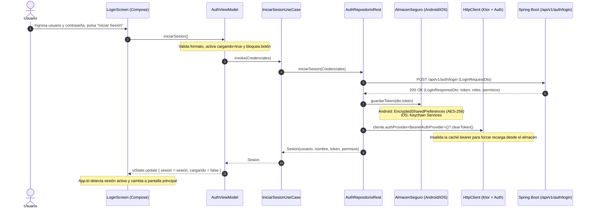

# Resultados de la Práctica de Laboratorio N.º 10
**Desarrollo de Aplicaciones Móviles — UPeU**  
**Docente:** David Reyna  
**Estudiante:** Lougui Acosta Medina  
**Semana:** 10 — Unidad 2  
**Tema:** Integración de Login, Token JWT y Protección de Solicitudes con Ktor  
**Fecha de Verificación:** 14/10/2026  
**Ramas Git:**
- Backend (`pharmaSoft`): `feature/auth-jwt-acosta` (Commit: `8ac676a`)
- Cliente (`PharmaMobile`): `feature/auth-jwt-acosta` (Commit: `9a14aea`)

---

## 1. Resumen Ejecutivo de Estados

| Componente | Plataforma / Módulo | Estado | Evidencia Principal |
| :--- | :--- | :---: | :--- |
| **Backend Spring Boot** | Java 21, Security, H2, JJWT | **APROBADO** | 21 tests unitarios OK. HTTP 401/200/403 verificados en vivo con puerto 8080 activo. Base de datos H2 conservada con sus 9 productos originales. |
| **Cliente Común (KMP Core)** | Shared `commonMain` | **APROBADO** | Clean Architecture estricta (Domain desacoplado de Ktor/Android/UIKit, Data, Presentation). Mappers DTO a Sesión, Casos de Uso y ViewModel con StateFlow. |
| **Pruebas Unitarias KMP** | Shared `desktopTest` | **APROBADO** | 18 tests completados exitosamente en `desktopTest` (`AuthRepositorioRestTest`, `ProductoViewModelTest`, etc.). |
| **Almacén Seguro Android** | Android (Keystore + Crypto) | **APROBADO** | `EncryptedSharedPreferences` con `MasterKey.Builder(AES256_GCM)`. Compilación `:androidApp:assembleDebug` exitosa (código 0). |
| **Almacén Seguro Desktop** | Desktop JVM | **APROBADO** | Almacenamiento seguro en memoria para depuración local; no persiste credenciales en texto plano. |
| **Almacén Seguro iOS** | iOS (Keychain Nativo) | **PENDIENTE ENTORNO** | Implementación completa mediante API C nativa de iOS (`Security.framework`: `SecItemAdd`, `SecItemCopyMatching`, `SecItemDelete`) sin TODOs. Pendiente de ejecución en máquina macOS con Xcode. |
| **Actividad Autónoma S10** | Expiración pasiva / activa | **NO EJECUTADO** | Reservado para la siguiente fase conforme a la consigna académica. |

---

## 2. Usuarios de Laboratorio y Matriz de Permisos

El backend fue sembrado de forma idempotente con contraseñas encriptadas con **BCrypt** (`$2a$10$...`) y los roles asignados:

| Usuario | Contraseña | Rol | Permisos Otorgados | Acceso a Catálogo | Acceso a Clientes / Ventas | Reportes |
| :--- | :--- | :--- | :--- | :---: | :---: | :---: |
| `admin` | `Admin123` | `ADMIN` | `CATALOGO_LEER`, `CATALOGO_ESCRIBIR`, `CLIENTES_LEER`, `CLIENTES_ESCRIBIR`, `VENTAS_LEER`, `VENTAS_REGISTRAR`, `REPORTES_VER`, `USUARIOS_ADMINISTRAR` | Lectura / Escritura | Lectura / Escritura | Sí |
| `vendedor` | `Vendedor123` | `VENDEDOR` | `CATALOGO_LEER`, `CLIENTES_LEER`, `CLIENTES_ESCRIBIR`, `VENTAS_LEER`, `VENTAS_REGISTRAR` | **Solo Lectura** | Lectura / Escritura | No |
| `almacen` | `Almacen123` | `ALMACENERO` | `CATALOGO_LEER`, `CATALOGO_ESCRIBIR` | Lectura / Escritura | **Prohibido (403)** | No |

### Expiración de Token
- **Algoritmo:** HMAC-SHA512 (`HS512`) mediante JJWT `0.12.6`.
- **Duración:** 3600 segundos (60 minutos).
- **Endpoint de renovación:** No existe en el servidor; al expirar el token el servidor responde HTTP 401 y el cliente borra la sesión forzando un nuevo inicio de sesión.

---

## 3. Recorrido Arquitectónico Completo

El flujo implementado cumple rigurosamente con la arquitectura Clean Architecture y MVVM reactivo con StateFlow:



---

## 4. Reconstrucción de Sesión al Reiniciar la Aplicación

Al abrir la aplicación, el usuario no debe volver a ingresar sus credenciales si el token almacenado sigue siendo válido:

1. `AuthViewModel.verificarSesionGuardada()` invoca `ObtenerSesionGuardadaUseCase()`.
2. `AuthRepositorioRest.sesionGuardada()` lee el token desde `AlmacenSeguro.leerToken()`.
3. Si el token existe, ejecuta `authApi.me()` (`GET /api/v1/auth/me`).
   - El plugin `Auth` de Ktor adjunta automáticamente la cabecera `Authorization: Bearer <token>`.
4. El servidor valida la firma y vigencia del JWT y retorna el `UsuarioResponseDTO`.
5. Se reconstruye el objeto `Sesion` con sus roles y permisos vigentes.
6. **Manejo de Excepciones:**
   - Si `/auth/me` responde **401 Unauthorized**: el token expiró o fue invalidado en el servidor; se ejecuta `cerrarSesion()` eliminando el token del almacén seguro y limpiando la caché bearer.
   - Si ocurre un fallo de red (**Timeout** o **IOException**): se arroja `ErrorSesion.SinConexion`, lo que permite a la interfaz notificar el problema de red **sin borrar el token del usuario** agresivamente.

---

## 5. Protección de Rutas y Manejo de Códigos de Error

### HTTP 401 (Unauthorized)
- **En `/api/v1/auth/login`:** Credenciales incorrectas. Se mapea a `ErrorSesion.CredencialesInvalidas` y se muestra "Usuario o contraseña incorrectos" en rojo sobre la pantalla de login.
- **En solicitudes autenticadas (ej. `/productos`):** Token ausente, alterado o expirado. `NetworkErrorHandler` arroja `ErrorApi.NoAutorizado`. La UI (`App.kt`) captura este estado, borra el token del almacén seguro, limpia el estado de sesión y devuelve inmediatamente al usuario a la pantalla de Login con el mensaje: *"Su sesión ha expirado o no es válida. Por favor, inicie sesión nuevamente."*

### HTTP 403 (Forbidden)
- Ocurre cuando el usuario está autenticado válidamente pero su rol carece del permiso exigido por `@PreAuthorize` o `SecurityConfig` (por ejemplo, el usuario `almacen` intentando acceder a `/api/v1/clientes`).
- `NetworkErrorHandler` arroja `ErrorApi.Prohibido`.
- **Comportamiento:** La sesión **SE CONSERVA** intacta (el usuario no es deslogueado). La interfaz muestra un `Snackbar` o banner de advertencia: *"Acceso Denegado (HTTP 403): No cuenta con los privilegios necesarios para esta operación."*

### Sanitización de Cabeceras en Logs
En `KtorClient.kt`:
```kotlin
install(Logging) {
    level = if (esDepuracion) LogLevel.HEADERS else LogLevel.NONE
    sanitizeHeader { header -> header == HttpHeaders.Authorization }
}
```
Esto garantiza que la cabecera `Authorization` se registre en Logcat como `Authorization: Bearer ***`, previniendo la fuga de tokens JWT en los registros de depuración del dispositivo.

---

## 6. Verificaciones de Compilación y Suite de Pruebas

### Backend (`pharmaSoft`):
```powershell
.\mvnw.cmd test
```
- **Resultado:** 21 tests ejecutados, 0 fallos, 0 errores.
- **Base de datos H2:** `./data/pharmadb.mv.db` preservada intacta con sus 9 productos y tablas de seguridad sembradas de forma no destructiva.

### Cliente KMP (`PharmaMobile`):
```powershell
.\gradlew.bat :shared:desktopTest
```
- **Resultado:** 18 tests completados exitosamente (`BUILD SUCCESSFUL in 2m 22s`).
- **Tests añadidos para S10:**
  1. `login_exitoso_guarda_token_y_retorna_sesion`
  2. `login_con_credenciales_invalidas_lanza_CredencialesInvalidas`
  3. `cerrar_sesion_borra_token_del_almacen`
  4. `sesionGuardada_reconstruye_sesion_con_auth_me`
  5. `sesionGuardada_con_token_expirado_401_limpia_almacen_y_retorna_null`

### Android App (`PharmaMobile`):
```powershell
.\gradlew.bat :androidApp:assembleDebug
```
- **Resultado:** `BUILD SUCCESSFUL in 1h 7m 43s`.
- APK generado en: `androidApp/build/outputs/apk/debug/androidApp-debug.apk`.
